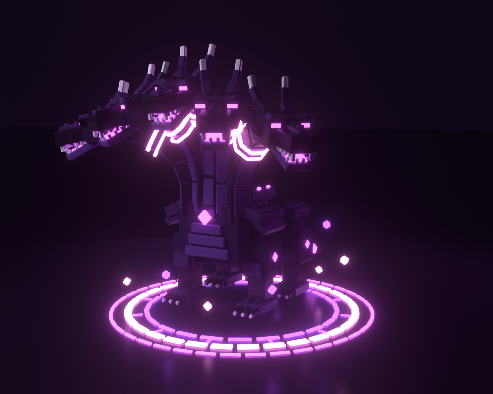
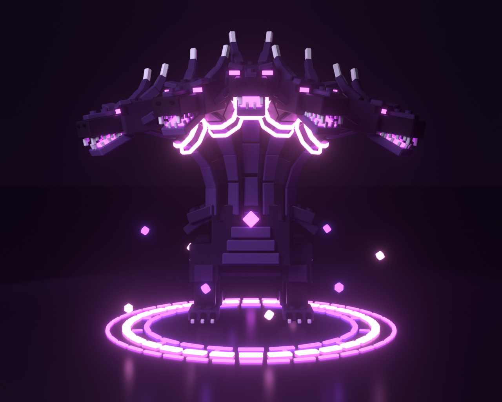
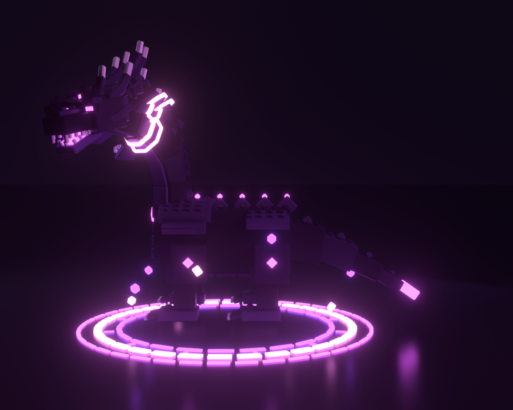

# Void Hydra: Blender model



A five-headed blocky hydra in the stud style. Every piece is a bevelled block, the body blocks carry real cylinder studs, and the collars, eyes, mouths, spike tips and the summoning circle are neon.

| File | What it is |
| --- | --- |
| `VoidHydra.blend` | The model, materials, lights and three cameras (Blender 5.1) |
| `export/VoidHydra.fbx` | For the Roblox 3D Importer. The palette texture is embedded. |
| `export/VoidHydra.glb` | glTF version of the same model |
| `export/VoidHydra_Palette.png` | The 256×16 colour palette every mesh is UV-mapped to |
| `renders/` | Hero, front and side renders (Cycles) |
| `build_void_hydra.py` | The script that builds everything above |




## How the model is split

There are 24 meshes, about 34k triangles in total. The largest is `Body` at about 7.5k, well under Roblox's 20k-per-MeshPart limit.

- `Body`, `Tail`, `Neck1`…`Neck5`: the dark studded blocks, coloured through the palette texture. Each neck mesh includes its head. In Blender, each object's origin sits on its pivot (neck base, tail base), so you can rotate it to pose or animate the pet.
- `*_NeonPink`, `*_NeonMagenta`, `*_NeonViolet`: the glowing pieces for each group, kept as separate meshes so they can use Roblox's Neon material.
- `Circle_*`: the summoning circle (three rings plus rune ticks). `Shards_*`: the floating crystals.

## Putting it in your Roblox game

1. In Studio, open **Avatar → Import 3D** (or File → Import 3D) and pick `export/VoidHydra.fbx`.
2. In the importer, check the size: the pet should be about **5.5 studs tall** and the circle about **5.8 studs wide**. If it isn't, change the importer's scale unit until it is, or resize the Model afterwards with the Scale tool.
3. Import it, name the resulting Model **`VoidHydraModel`** and move it into **ReplicatedStorage**.
4. Add the scripts from `src/` (see the main README): `VoidHydra` and `ImportedPet` as ModuleScripts in ReplicatedStorage, and `PetFollower` as a LocalScript in StarterPlayerScripts.
5. Press Play. `PetFollower` finds `VoidHydraModel` and uses it. `ImportedPet` switches the `_Neon*` MeshParts to the Neon material in the right colours, spins the rings in opposite directions, orbits the shards, bobs the body and makes the glow pulse.

If the pet faces backwards, set `ImportedPet.Facing = CFrame.Angles(0, math.pi, 0)` in `ImportedPet.lua`.

If you'd rather place it by hand without the scripts, select every MeshPart whose name ends in `_NeonPink`, `_NeonMagenta` or `_NeonViolet` and set **Material = Neon** with these colours: pink `#FF8BF0`, magenta `#E35CFF`, violet `#A64DFF`.

## Rebuilding or changing it

```
blender -b -P build_void_hydra.py -- --render --samples 64
# or, with the bpy module:  pip install bpy==5.1.2 && python build_void_hydra.py --render
```

Without `--render` it only rebuilds the `.blend` and the exports, in about two seconds. Values you can change at the top of the script include `SCALE` (overall size), `HOVER`, `NECKS`, `NECK_SEGMENTS`, the stud size and pitch, and `PALETTE`.
