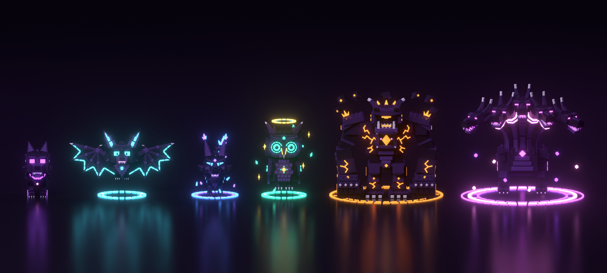

# Void pets



Five new pets in the same blocky, studded style as the Void Hydra. Each is built from bevelled blocks with real studs, in the hydra's dark body colours, with its own signature glow. All of them use the shared builder in [`../lib/blocky.py`](../lib/blocky.py), so studs, scale and naming match the hydra exactly.

| Pet | Suggested rarity | Size (studs, W × D × H) | Triangles | Glow |
| --- | --- | --- | --- | --- |
| [VoidPup](VoidPup/renders/hero.png) | Common | 1.4 × 3.3 × 2.6 | 9,452 | violet `#A64DFF`, pink collar gem |
| [ShadowBat](ShadowBat/renders/hero.png) | Uncommon | 4.9 × 2.3 × 3.2 | 12,640 | cyan `#4DE1FF`, pink mouth and ring ticks |
| [CrystalFox](CrystalFox/renders/hero.png) | Rare | 2.2 × 3.9 × 3.0 | 15,964 | ice `#4D8EFF`, lilac `#7D5EFF` crystals |
| [NebulaOwl](NebulaOwl/renders/hero.png) | Epic | 2.7 × 2.6 × 3.5 | 19,224 | teal `#3FF2C8`, gold `#FFCF4D` halo |
| [RuneGolem](RuneGolem/renders/hero.png) | Legendary | 5.3 × 5.3 × 4.7 | 20,020 | amber `#FF9A3C` runes, pink core sparks |
| [VoidHydra](../README.md) | Mythic | 5.8 × 7.0 × 5.5 | 33,880 | pink, magenta, violet |

The rarities are suggestions based on size and detail. Set them to match your game's pet system. Every mesh is under Roblox's 20,000-triangle limit per MeshPart. The largest is the NebulaOwl head at 4,204.

- **VoidPup:** A chibi wolf pup with a studded head, a swept-back mane, fangs, a violet collar with a framed pink gem tag, toed paws with bone claws, and a curled tail with a flame tip.
- **ShadowBat:** Hovers over a cyan ring. It has huge glowing ears, real jointed bat wings with plate finger bones, and segmented cyan strips along scalloped wing edges.
- **CrystalFox:** Stands in an ice-and-lilac circle, with crystal-tipped ears, a crystal ridge down its back, and a bushy tail ending in a crystal burst.
- **NebulaOwl:** Hovers under a spinning gold halo. It has concentric teal eyes, a hooked beak, shingled feather layers, runed folded wings and orbiting star shards.
- **RuneGolem:** A hunched stone gorilla golem with huge fists, amber rune cracks spreading from a faceted chest core, crystals on its hump, and rocks orbiting above a double amber ring.

Each folder holds `build.py` (the source), `<Name>.blend`, `export/<Name>.fbx` (for Roblox), `export/<Name>.glb`, `export/<Name>_Palette.png`, and hero, front and side renders.

## Putting them in your Roblox game

1. In Studio, use **Import 3D** on each `export/<Name>.fbx`. Check the size the importer shows against the table above, and adjust the importer's scale unit if it's off.
2. Put the imported Models in a **ReplicatedStorage** folder named **`PetModels`**, each named exactly as in the table: `VoidPup`, `ShadowBat`, `CrystalFox`, `NebulaOwl`, `RuneGolem`, `VoidHydra`.
3. `src/ReplicatedStorage/ImportedPet.lua` knows every glow colour. It turns each `_Neon<Colour>` MeshPart into Neon in the right colour, spins `Circle*` rings and halos, orbits `Shards*` pieces and bobs the body.
4. If you're using the included `PetFollower` to test, set a player's `EquippedPet` attribute on the server, for example `player:SetAttribute("EquippedPet", "NebulaOwl")`. With no attribute, players get the hydra. Once your game's own pet system shows these models, you don't need `PetFollower`.

Body parts are separate meshes with pivots at their joints in Blender (Head, EarL/EarR, WingL/WingR, ArmL/ArmR, LegFL…, Tail). That makes them ready for rigging or scripted animation, though `ImportedPet` only bobs the whole body for now.

## Rebuilding

```
python VoidPup/build.py --render          # bpy module (pip install bpy==5.1.2), or:
blender -b -P VoidPup/build.py -- --render
python render_lineup.py                    # lineup.png of all six
```

The renders are a little darker and more saturated than the pets will look in-game. Roblox's Neon material uses the exact hex colours listed above.
