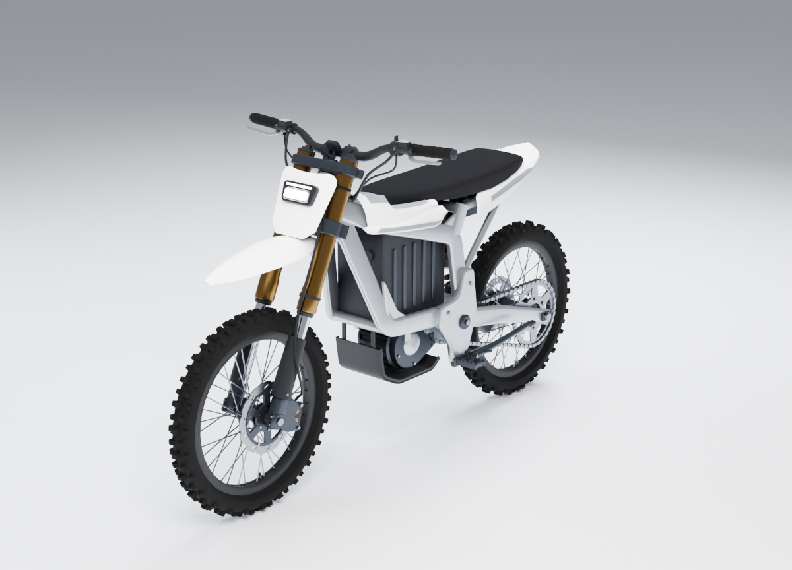
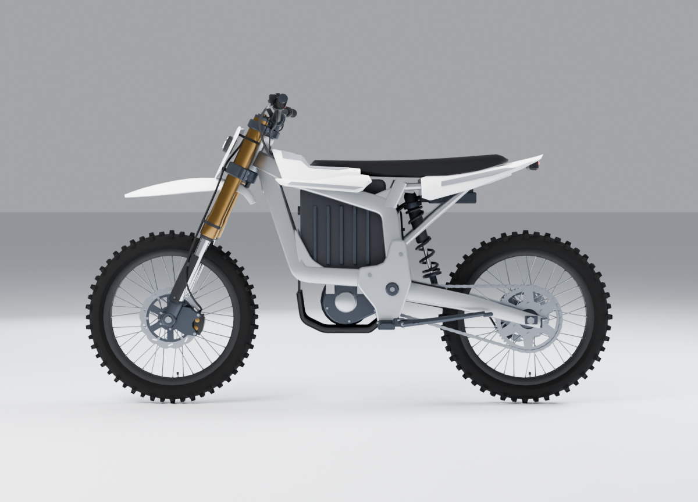

# Sur-Ron Light Bee X: Blender model



A mid-poly Sur-Ron Light Bee X (also sold as the Light Bee 2) electric dirt bike for Roblox. It has smooth, rounded, real-world shapes rather than blocks or studs. It has a white bodywork and long flat black seat, a silver forged frame around a black slatted battery, gold upside-down fork tubes, and 19" spoked wheels with knobby tyres. There are no logos or brand text on the model.

| File | What it is |
| --- | --- |
| `SurRonLightBee.blend` | The model, its material, studio lights and four cameras (Blender 5.1) |
| `export/SurRonLightBee.fbx` | For the Roblox 3D Importer, in studs. The colour and emission maps are embedded. |
| `export/SurRonLightBee.glb` | glTF version, with colour, metal/roughness and emission textures |
| `export/SurRonLightBee_Color.png`, `_Metalness.png`, `_Roughness.png`, `_Emission.png` | The 256×16 palette maps every mesh is UV-mapped to |
| `renders/` | Hero, side, front and rear renders (Cycles) |
| `build.py`, `spec.py`, `parts/*.py` | The scripts that build everything above |



## How the model is split

There are 10 meshes and about 42,800 triangles in total. The largest mesh is `Body` at about 13,200 triangles, well under Roblox's 20,000-per-MeshPart limit. Each mesh's origin sits on its pivot, so moving parts can turn about their real hinge points.

Positions are in studs from the model origin, which sits on the ground under the middle of the wheelbase. They use Blender's axes: X is the rider's left, Y points to the back of the bike and Z is up. The bike faces -Y. When you import the FBX, Blender's Z becomes Roblox's Y (up).

| Mesh | What it holds | Pivot (studs) | How it moves |
| --- | --- | --- | --- |
| `Body` | Frame, battery, motor, footpegs, kickstand, plastics, seat | (0, 0, 0) | Fixed |
| `Body_NeonRed` | Tail-light LED | (0, 0, 0) | With `Body` |
| `Swingarm` | Swingarm, chain, rear caliper, rear axle | (0, 0.536, 1.500) | Hinges about X |
| `Shock` | Shock body, top eye, spring | (0, 0.750, 2.750) | Hinges about X; aim it at the `ShockRod` pivot |
| `ShockRod` | Lower eye, rod end, chrome shaft | (0, 1.107, 1.482) | Rides on the swingarm; aim it at the `Shock` pivot |
| `Steering` | Clamps, gold fork tubes, bar and controls, number plate, headlight, front fender | (0, -1.278, 2.939) | Turns about the steering axis (0, 0.423, 0.906): up and back, 25° rake |
| `Steering_NeonWhite` | Headlight LEDs | same as `Steering` | With `Steering` |
| `ForkLowers` | Chrome stanchions, axle feet, fork guards, front caliper, front axle | (0, -2.250, 1.107) | Turns with `Steering`; slides up the steering axis for fork travel |
| `FrontWheel` | Tyre, rim, spokes, hub, front disc | (0, -2.250, 1.107) | Spins about X; follows `ForkLowers` |
| `RearWheel` | Tyre, rim, spokes, hub, rear disc, sprocket | (0, 2.250, 1.107) | Spins about X; follows `Swingarm` |

Limits the model is built for:

- **Steering:** about ±35°. Beyond that, the gold tubes reach the shroud at about 45°. Near full lock, the cable ends inside the shroud can poke through its front edge.
- **Fork travel:** up to 0.21 studs (60 mm) before the fork guards reach the dust wipers. The front brake hose is in two halves, one on `Steering` and one on `ForkLowers`, which overlap a little as the fork compresses.
- **Rear suspension:** each frame, turn `Shock` about its pivot so it points at the `ShockRod` pivot. Turn `ShockRod`, which moves with the swingarm, so it points back at the `Shock` pivot. The shaft then slides into the shock body. The spring is solid and stays attached to `Shock`. As soon as the shock compresses, its lowest coil starts to pass through the spring seat.

## Putting it in your Roblox game

1. In Studio, open **Import 3D** and pick `export/SurRonLightBee.fbx`.
2. Check the size in the importer. The bike should be about **6.7 studs long, 2.9 studs wide and 3.9 studs tall**. The FBX coordinates are in studs, but the file declares metres. If the bike comes in about 24 studs long, change the importer's scale unit until the size is right, or scale the Model down afterwards.
3. Check which way it faces. Its nose points along Blender's -Y. If your vehicle script expects the front somewhere else, rotate the Model.
4. **Materials:** the FBX carries only the colour and emission maps. For metal and roughness, add a `SurfaceAppearance` to each MeshPart and set three maps from `export/`:
   - `ColorMap` = `SurRonLightBee_Color.png`
   - `MetalnessMap` = `SurRonLightBee_Metalness.png`
   - `RoughnessMap` = `SurRonLightBee_Roughness.png`

   Without these, the gold fork, aluminium frame and chrome all look like plastic.
5. **Lights:** set `Body_NeonRed` and `Steering_NeonWhite` to **Material = Neon** with the colours `#FF2A2A` (tail light) and `#F4F8FF` (headlight).
6. **Pivots:** keep each MeshPart's pivot where it imports, which is the table above. Use them for the hinges: a HingeConstraint or Motor6D at the `Swingarm`, wheel and `Steering` pivots, and a prismatic constraint along the steering axis for `ForkLowers`.
7. **Render fidelity:** the brake discs and sprocket have a few long, thin triangles across their flat faces. They shade correctly, but if they shimmer at a distance, set `RenderFidelity = Precise` on `FrontWheel` and `RearWheel`.

## Rebuilding or changing it

```
python build.py --render                     # full build: .blend, exports and the four renders
python build.py --only chassis,bodywork --render --samples 16 --res 800 --views hero,side --no-export
```

Use the `bpy` 5.1 module (`pip install bpy==5.1.2`). All measurements, pivots, triangle budgets and the palette live in `spec.py`. Each file in `parts/` builds one area of the bike: `chassis`, `wheels`, `front_end` and `bodywork`.

A test build (`--only` or `--no-export`) writes only renders. A full build rewrites the exports and the `.blend`.

`build.py` rewrites the metalness, roughness and emission maps after the model is finished and stops with an error if they come out wrong. This guards against an older `midpoly.py` bug that left those maps blank; the toolkit itself is now fixed.
